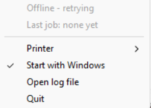

# PrintEase

PrintEase is a simple web-based remote printing service. Users can upload PDF documents, choose print settings (copies, color/B&W, single/double sided, paper size), pay online via Razorpay, and their documents are automatically sent to a remote printer.

The project is organized into two main folders:
1. `server/` – The web application backend, database, and admin dashboard.
2. `printer-pc/` – The lightweight client app that runs on the computer connected to the printer.

---

## Project Structure

```
printease/
├── server/           # Central backend (FastAPI, PostgreSQL, Admin Web UI)
│   ├── authentication/
│   ├── models/
│   ├── resource/
│   ├── routers/
│   ├── schemas/
│   ├── services/
│   ├── static/
│   ├── templates/
│   ├── utils/
│   ├── config.py
│   ├── create_admin.py
│   ├── Dockerfile
│   ├── docker-compose.yml
│   ├── requirements.txt
│   ├── .env.example
│   └── main.py
│
├── printer-pc/       # Client application for the printer machine
│   ├── PrintEaseAgent.exe          # Pre-compiled executable (ready to run)
│   └── agent_config.json          # Configuration file (server URL & token)
│
├── docs/             # Documentation assets
│   └── system_tray.png
│
└── README.md
```

---

## 1. Printer PC Setup (`printer-pc/`)

This runs on the Windows computer physically connected to the printer.

### Files inside `printer-pc/`:
- `PrintEaseAgent.exe`: Standalone program that listens for print jobs and sends them to your printer.
- `agent_config.json`: Configuration file for server connection.

### How to use:

1. **Configure the connection:**
   Open `agent_config.json` in Notepad (right-click and choose **Open with > Notepad**):
   ```json
   {
     "server_url": "http://localhost:8000",
     "agent_token": "your_agent_token"
   }
   ```
   - `server_url`: The address of your running PrintEase server (e.g., `http://localhost:8000` or your hosted domain).
   - `agent_token`: Secret token that matches `AGENT_TOKEN` in `server/.env`.

2. **Run the program:**
   - Double-click `PrintEaseAgent.exe`.
   - It will start and appear as an icon in your **Windows System Tray** (bottom-right corner, near the clock).

3. **Select your printer:**
   - Right-click the PrintEase icon in the System Tray.
   - Hover over **Printer** and choose your printer from the list of installed Windows printers.
   - The app will now automatically poll the server for pending jobs and print them as they arrive.

4. **Run automatically on Windows startup:**
   - Right-click the PrintEase icon in the System Tray and click **Start with Windows** to toggle it on (a checkmark `✓` will appear).
   - The program will now start automatically whenever Windows boots up.



---

## 2. Server Setup (`server/`)

The server handles user logins, file uploads, payments, and manages the print queue.

### Requirements:
- Docker & Docker Compose (easiest way to run)
- Or Python 3.13 for manual running

### Configuration:

Create a `.env` file inside the `server/` folder by copying `server/.env.example`:

```bash
# In the project root, copy the example file
cp server/.env.example server/.env
```

Open `server/.env` in a text editor and fill in your values (database credentials, Razorpay API keys, and `AGENT_TOKEN`).

### Running the server with Docker:

```bash
cd server
docker compose up --build -d
```
The website will be available at `http://localhost:8000`.

### Creating an Admin account:

To access the admin dashboard:

```bash
# If running with Docker
docker compose exec web python create_admin.py

# If running locally
python create_admin.py
```
Enter an email and password when prompted.

---

## 3. Admin Dashboard & Print Control

Admins can manage the entire printing process through the web browser at `http://localhost:8000/admin/dashboard`:

- **Printer Status:** Shows whether the printer agent is currently online or offline, and which printer is selected in the system tray.
- **Start / Stop Receiving Jobs:**
  - Click **Stop receiving jobs** to pause sending prints (e.g., when refilling paper or toner).
  - Click **Start receiving jobs** to resume printing.
- **Manage Orders:** View live print status, retry failed jobs, preview PDFs, and mark completed jobs as delivered (which deletes the file from disk).
